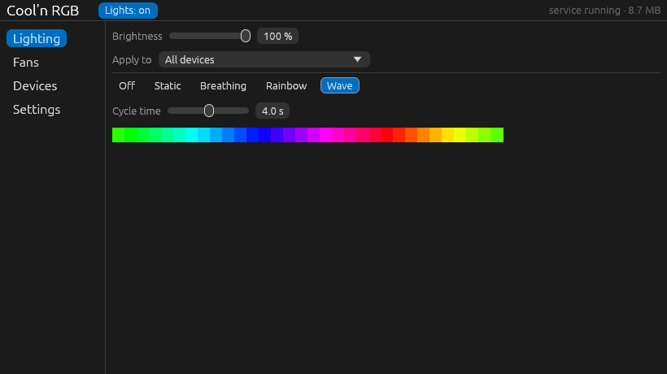
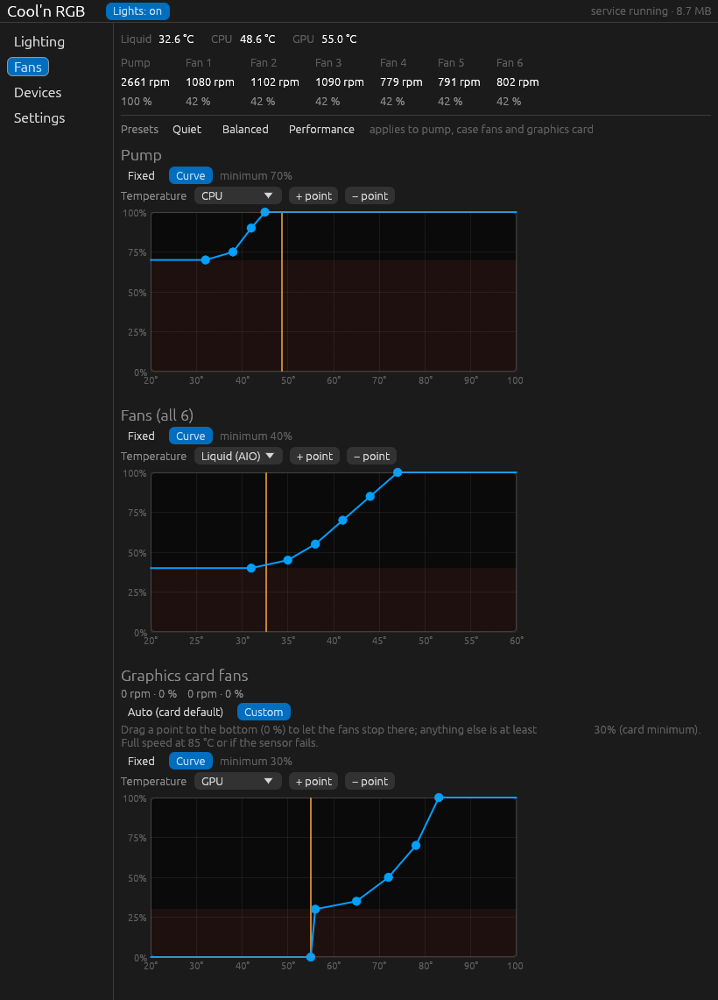
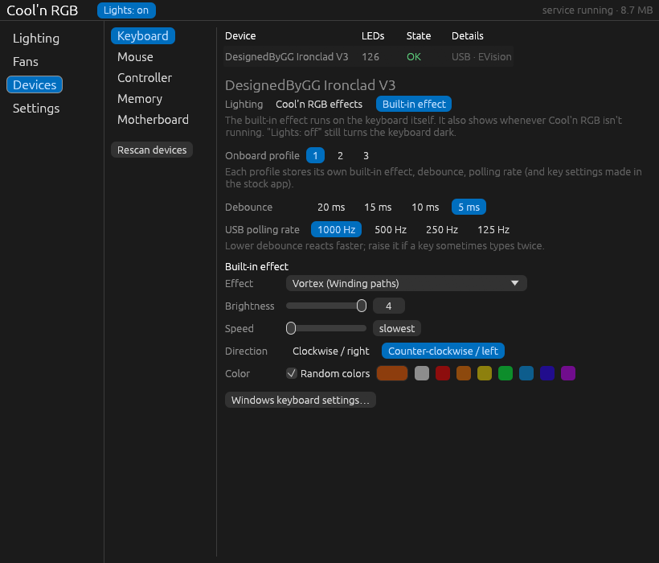

# Cool'n RGB

RGB lighting, fan curves, and peripheral settings in a small Windows app, written in Rust.

Built to replace SignalRGB and iCUE on my PC. It controls the Commander Core, RAM, motherboard lighting, keyboard, and mouse from one panel. Hardware support is specific to the devices below; this isn't a general-purpose RGB controller yet.



The background process, `coolrgbd.exe`, handles the hardware and lives in the system tray. The control panel, `coolrgb.exe`, only runs while you have it open. Closing the window leaves lighting and cooling running and frees the panel's memory. The service reports about **9 MB of private memory** on this PC in the screenshots; usage depends on the devices and effects.

## What it does

- **Lighting:** Off, Static, Breathing, Rainbow, and Wave, with brightness and cycle time controls. Use one effect everywhere or override it per device and per Commander Core LED port. The master switch turns the lights off without losing your effects.
- **Cooling:** drag points on pump, case-fan, and NVIDIA GPU fan curves, or choose fixed speeds. Curves can follow liquid, CPU, GPU, or the hottest available reading. Quiet, Balanced, and Performance presets apply to all three at once.
- **Peripherals:** adjust Harpoon DPI stages and polling rate, or use the Ironclad's onboard lighting, profiles, debounce, and polling rate.
- **Device recovery:** rescan manually, or let the service reconnect after sleep and USB unplug/replug.

<details>
<summary>Fan controls — live temperatures, RPM, and editable curves</summary>

The orange line marks the current temperature. The shaded red area is below the minimum running speed. GPU fans can stop at points set to 0%; Balanced leaves them on the card's automatic control.



</details>

<details>
<summary>Device controls — Ironclad V3 onboard settings</summary>



</details>

## Hardware

Tested on this PC. Similar names or a shared manufacturer don't guarantee compatibility.

| Device | Supported controls |
| --- | --- |
| Corsair iCUE Commander Core | Lighting for the pump and six fan ports (125 LEDs on this setup), pump/fan speed, RPM, liquid temperature |
| Corsair Vengeance RGB Pro DDR4 ×2 | Lighting over SMBus, at addresses `0x58` and `0x5A` |
| MSI B450 TOMAHAWK | Onboard RGB through Nuvoton Super-IO; one zone, 4-bit color |
| Corsair Harpoon RGB Wireless, connected by USB cable | Lighting, five DPI stages and DPI button, polling rate, angle snapping, sleep timer, battery status |
| DesignedByGG Ironclad V3 (`320F:511E`) | Lighting across key columns, onboard effects and profiles, debounce, polling rate |
| AMD Ryzen / NVIDIA GPU | Ryzen Tctl and GPU temperatures for curves; NVIDIA fan control |

The Corsair K57 RGB Wireless via Slipstream is **not supported** and is not planned.

Protocol references and device-specific findings are in [docs/PROTOCOLS.md](docs/PROTOCOLS.md), based on OpenRGB, OpenLinkHub, and liquidctl.

## Build and install

You need Windows, Rust with the MSVC toolchain, and the Visual Studio C++ build tools with a Windows SDK. Install [PawnIO](https://pawnio.eu) for RAM lighting, motherboard lighting, and CPU temperature access. The signed PawnIO modules are included in the repository; the driver still needs to be installed separately.

1. Quit other software controlling these devices, including SignalRGB and iCUE. For SignalRGB, also stop `SignalRgb.Service` and set its startup type to **Manual** in `services.msc`, or uninstall it.
2. From the repository root, build both executables:

   ```powershell
   powershell -ExecutionPolicy Bypass -File scripts\build.ps1
   ```

3. In an **administrator PowerShell**, install:

   ```powershell
   powershell -ExecutionPolicy Bypass -File scripts\install.ps1
   ```

   This copies the executables to `C:\Program Files\CoolRGB`, adds a Start menu shortcut, and starts the background process.

4. Open **Cool'n RGB** from the Start menu or the rainbow tray icon. Enable **Settings → Start with Windows** to start the service at logon. This uses Task Scheduler to launch it with administrator rights without a UAC prompt each time.

Changes apply live. There is no separate Save button.

To uninstall, run this from an administrator PowerShell:

```powershell
powershell -ExecutionPolicy Bypass -File scripts\uninstall.ps1
```

Add `-KeepSettings` to preserve your configuration.

## Fan safety

The service enforces these limits even when a curve requests a lower speed:

- Commander Core fans: **40% minimum**. Pump: **70% minimum**.
- Pump and case fans go to **100% at 50 °C liquid or 95 °C CPU**, or if the sensor required by their curve is unavailable.
- Custom GPU control goes to **100% at 85 °C**, or if its curve's sensor is unavailable. Nonzero GPU speeds have a **30% minimum**; 0% returns the card to automatic control so it can stop its fans.
- Pump and case-fan speeds rise immediately and fall by at most **3 percentage points per second**.

On a normal exit, the Commander Core returns to the hardware profile saved by iCUE. On this setup, it also returned to that profile within about a minute after a crash or forced termination. That fallback was tested on this hub.

## Settings and logs

| File | Purpose |
| --- | --- |
| `C:\ProgramData\CoolRGB\config.json` | Lighting, curves, device overrides, and startup settings |
| `C:\ProgramData\CoolRGB\daemon.log` | Device and service diagnostics; capped at 256 KB |

If the panel can't reach the service, use **Start background service** and accept the administrator prompt. If a device is missing, check the log and try **Devices → Rescan devices**. For Commander Core fans with dark or incorrect LEDs, check the fan type for each LED port under **Devices → Controller**.

## Working on it

| Directory | Contents |
| --- | --- |
| `crates/core` | Device protocols, effects, configuration, IPC, sensors, and PawnIO bindings |
| `crates/daemon` | Tray icon, hardware workers, fan control, and named-pipe server |
| `crates/gui` | egui control panel; uses shared types without linking device drivers |
| `vendor/pawnio` | Signed PawnIO modules embedded in the binaries |

Drivers live under `crates/core/src/devices/`, grouped by manufacturer and protocol. Each protocol module lists supported devices by VID/PID. Manufacturer features (`corsair`, `evision`, `msi`) are all enabled by default; disabling one removes its driver code and unused PawnIO modules. For example:

```powershell
cargo build --release -p coolrgbd --no-default-features --features corsair
```

RAM animation runs at 10 fps and skips unchanged frames: SMBus writes busy-wait inside PawnIO, so updating RAM has a higher CPU cost than USB lighting. Static colors don't need continuous writes.

Useful examples, run with `cargo run --release -p coolrgb-core --example <name>`:

- `probe`: read-only USB dump.
- `pawn_test`: temperature readings and DRAM/Super-IO detection.
- `ctl`: named-pipe client with `status`, `config`, `set file.json`, `quit`, and `handover`. Handover exits without restoring hardware lighting profiles.
